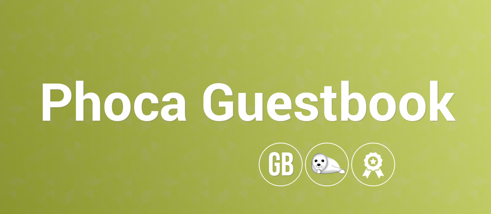

# Phoca Guestbook

## Phoca Guestbook — Community-Driven Extension for Joomla CMS

Phoca Guestbook is Joomla! CMS component. It displays guestbook form with Captcha (8 types of Captcha) and many other different internal or external spam protection methods.

### Free and Open Source Software (FOSS) Declaration

This project is developed, distributed, and maintained strictly as **Free and Open Source Software (FOSS)**. It is provided entirely outside the course of any commercial activity as an independent public resource.

Our compliance with the principles of free and open-source software is established by the following structural and operational guidelines:

* **Strictly Non-Commercial & Public Good:** This software is provided 100% free of charge. No commercial entities control or fund this repository, and there are no commercial monetization models, paid subscriptions, or premium paywalls associated with this codebase.
* **Independent Volunteer Contributions:** The development, maintenance, and testing of this extension are driven entirely by independent, voluntary contributions from the global community.
* **No Commercial Technical Support:** Technical support is not provided as a paid commercial service by the maintainers of this repository. Community assistance is available on a voluntary, non-binding basis via public forums.
* **No Proprietary Lock-in:** The software is licensed under the copyleft GNU General Public License (GPL). You have absolute freedom to run, study, share, modify, and redistribute the code.
* **Decentralized Infrastructure:** This codebase is hosted in a public, transparent repository on GitHub to foster open collaborative development and public peer review, ensuring safety and quality through community vigilance.

*This repository is a shared community resource dedicated to the global open-source ecosystem.*

## Project page

[Phoca Guestbook](https://www.phoca.cz/phocaguestbook)

[Phoca Guestbook Info Page](https://www.phoca.cz/project/phocaguestbook-joomla-guestbook)

## Documentation

[Documentation](https://www.phoca.cz/documentation/category/3-phoca-guestbook-component)

## Support

[Phoca Forum](https://www.phoca.cz/forum)

:bell: [Phoca Forum RSS](https://www.phoca.cz/forum/app.php/feed)

## News

[Phoca News](https://www.phoca.cz/news)

:bell: [Phoca News RSS](https://www.phoca.cz/news?format=feed&type=rss)

:bell: [Phoca Latest Releases RSS](https://www.phoca.cz/download/feed/111?format=feed&type=rss)

## Demo

[Joomla! 3 Demo](https://www.phoca.cz/joomla3demo/phocaguestbook')

## Version (Joomla! 3.x)

3.0.12

## Version (Joomla! 4.x)

4.0.5

## Version (Joomla! 5.x)

5.0.0

## License

GNU/GPL

This project is open source project - feel free to contribute! Thank you.

## Social Media

- [Phoca on Facebook](https://www.facebook.com/Phoca.cz)

- [Phoca on X (Twitter)](https://twitter.com/PhocaCz)

- [Phoca on YouTube](https://www.youtube.com/user/phocavideos)

- [Phoca on GitHub](https://github.com/PhocaCz)

- [Phoca on Reddit](https://www.reddit.com/user/PhocaCz)
